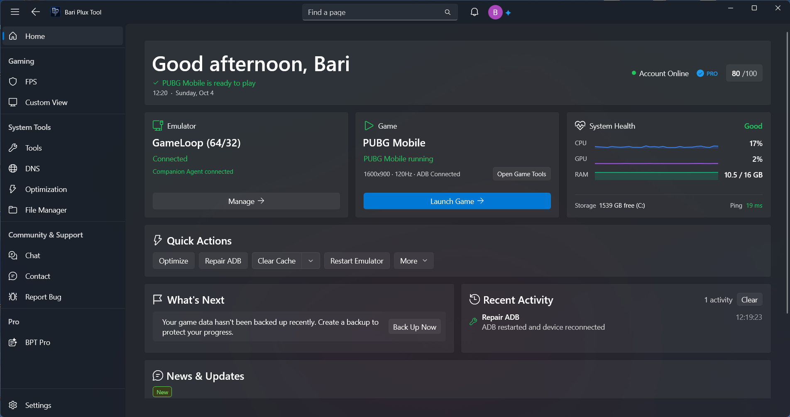

# Bari Plux Tool

**Created by Snow Breaker · A Bari Plux product**

BPT started as a personal tool for PUBG Mobile graphics settings and GameLoop keymapping. Community support helped turn it into a broader application for players and emulator users.

| Platform | Status | Official release |
| :--- | :--- | :--- |
| **PC / Original application** | First public release | 16 November 2025 |
| **PC / WinUI 3 rewrite** | Released | 12 October 2026 |
| **Android** | **Coming Soon** | Not announced |

Status updated: 21 October 2026.

## A look inside BPT

The Windows Home dashboard. Open the image to view the interface at full resolution.

## BPT for Windows

- **Graphics & controls:** FPS and graphics settings, Custom View, keymapping and control profiles.
- **Performance:** optimization tools, Game Mode and an in-game performance overlay.
- **Files & emulators:** Installed Files for emulators, file management, installation utilities, backup and restore.
- **Connected features:** accounts, cloud backup, community chat, announcements and support.
- **Everyday experience:** themes, updates and **27 languages**, including right-to-left interfaces.

Feature availability varies by emulator, hardware and plan. FPS settings depend on game and device support.

**[Official product information & download options →](https://bariplux.com/tool)**

## BPT Android · Coming Soon

The mobile product is planned around gaming tools, device and network insight, accessible file management, backups and shared account features. A central goal is connecting BPT PC and Android, including planned remote PC / GameLoop management.

Feature support depends on device capabilities and permissions. Some advanced features may require root. No Android release date has been announced.

## The story behind BPT

1. **Personal beginnings:** adjust graphics / FPS settings and GameLoop keymapping for an iPad-style layout, now known as Custom View.
2. **16 November 2025:** official PC launch. Community requests helped expand the product into DNS tools, PAK backups, additional languages and optimization.
3. **Summer 2026:** development of a larger WPF redesign with Game Mode and a file manager.
4. **31 July 2026:** the developer / VIP preview prompted a rethink of the interface and a decision to rewrite with WinUI 3.
5. **12 October 2026:** official release of the rewritten PC application.
6. **Next:** Android and a more connected PC / mobile experience.

[Case study: why I rewrote BPT with WinUI 3 →](./docs/wpf-to-winui3.md)

## Ownership & scope

Snow Breaker is the creator behind Bari Plux and leads the product direction and development described here. Community ideas and early feedback help shape the work.

This repository contains public product information. Application source code is maintained privately. The official website is the source for current releases, availability and download options.

[Website](https://bariplux.com) · [Creator](https://github.com/Snow-Breaker) · [Discord](https://discord.com/invite/fQkyq8VR59) · [Telegram](https://t.me/BariPlux)

Support: [Support@BariPlux.com](mailto:Support@BariPlux.com)
